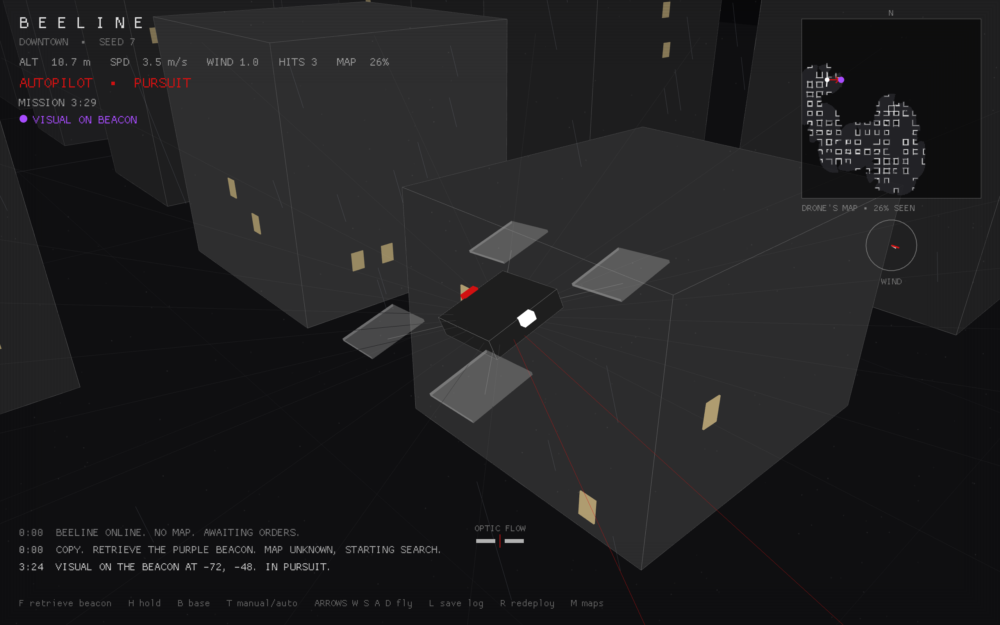

<div align="center">


# B E E L I N E

**An autonomous drone, alone in a rain-soaked city it has never seen.**<br>
**It has one order: find the purple beacon and bring it home.**

[](https://github.com/alex-quiterio/beeline/actions/workflows/ci.yml)




<sub>*3 minutes 29 seconds in. The drone has mapped 26% of Downtown on its own, spotted the beacon, and is closing in.*</sub>

</div>

---

## The pitch

Drop a quadcopter into a city it has **no map of**. Somewhere in the streets, a purple beacon is drifting around, and it **runs** when the drone gets close. The drone has to:

1. **Map** the city as it flies, from its own lidar.
2. **Search** intelligently, including streets it already checked, because the beacon moves.
3. **Chase** the beacon once it's spotted, aiming where it *will be*, not where it is.
4. **Grab** it, **fly home**, and **land** on the pad.
5. **File a flight log** in the format real PX4 drones use, so the *next* drone into this city starts with a map.

All of it while dodging sliding gates, rising lifts, spinning fans and patrol drones, in gusting wind.

```console
$ cargo run --release --example mission -- docks 7
  0:00  BEELINE ONLINE. NO MAP. AWAITING ORDERS.
  0:00  COPY. RETRIEVE THE PURPLE BEACON. MAP UNKNOWN, STARTING SEARCH.
  4:48  VISUAL ON THE BEACON AT 0, 72. IN PURSUIT.
  4:57  GOT IT. BEACON SECURED. HEADING HOME.
  5:06  OVER THE PAD. SETTING DOWN.

THE DOCKS seed 7: delivered at 5:09, 28% of the city mapped
flight log: logs/beeline_the_docks_7_1793777891.ulg
```

## Quick start

```bash
cargo run --release                     # pick a map, then press F to give the order
cargo run --release -- --map docks --retrieve           # straight into a mission
cargo run --release --example mission -- downtown 3     # fly headless, print the radio, save the log
cargo test --release                    # unit tests + full headless missions + log round trip
cargo test --release -- --ignored --nocapture           # benchmark: 10 cities, blind vs fleet intel
```

| Key | Order |
|---|---|
| **F** | *"Retrieve the purple beacon."* The drone acknowledges and takes over |
| **H** / **B** | Hold position / return to base |
| **T** | Toggle manual ↔ autopilot (manual is position mode: let go and it holds in the wind) |
| **Arrows**, **W S**, **A D** | Fly: move, climb/descend, turn |
| **L** | Save the flight log now (it also saves itself when a mission completes) |
| **R** / **M** | Redeploy / back to the map menu |

## Two cities

| | **DOWNTOWN** | **THE DOCKS** |
|---|---|---|
| Feel | Rain-slick canyons of stone and glass | Container mazes and cranes by the black water |
| Layout | 16 m grid, towers up to ~40 m, tallest in the centre | 24 m grid: warehouses, stacked container yards with narrow alleys, gantry cranes to fly *under* |
| Size | ~300 × 300 m | ~350 × 350 m |
| Hazards | Sliding gates, rising lifts, spinning fans, patrol drones, gusting wind (both cities) | same |

Cities are generated from a seed, so every run and every bug is exactly reproducible. Press **N** in the menu for a new city.

## What you're looking at

- **Red** is the drone and its intent: the nose light, the planned route on the ground, lidar rays that are close to something.
- **Purple** is the beacon, the only other colour in the city.
- **Top right: the drone's own map**, built live from its lidar. White is walls, grey is open ground, black is unexplored. The red line is its route, the red cross its current goal, the purple dot its last sighting of the beacon.
- **Wind compass:** the true wind (white) vs. what the flight controller has *estimated* (red). The estimate is learned purely from how the drone drifts.
- **Optic flow bars:** the bee's "eyes" (see below). When the bars are balanced, the drone is centred in the street.
- **Radio log:** the drone narrates its decisions, and every line also goes into the flight log.

## How it works

### Architecture

Layered like real drone software. Dependencies only point downwards, and the autonomy code has **never heard of the simulator**:

```
  main · render (binary)          viewer: input, fixed 60 Hz loop + interpolated rendering, noir graphics
          │
  telemetry · fleet               flight recorder (PX4 ULog) · terrain rebuilt from other drones' logs
          │
  sim ─────────┐    nav           the world (Rapier, cities, beacon)  ·  autonomy (perception, mission, guidance)
               │     │
               └──► flight        flight controller: velocity setpoint → stick inputs
                     │
  sensors · vehicle               shared contracts: what can be sensed · what the airframe is
```

| Module | What it does |
|---|---|
| [`vehicle`](src/vehicle.rs) | Airframe constants, stick `Inputs`, estimated `State`. Physics and controller both depend on it, never on each other. |
| [`sensors`](src/sensors.rs) | The `Sensors` trait (range rays, camera, payload hook). **The autopilot's only window onto the world.** |
| [`flight`](src/flight.rs) | PX4-style cascade: setpoint rate limiter → PI velocity control + drag feedforward → tilt and throttle. The integral term doubles as a wind estimator. |
| [`nav/mission`](src/nav/mission.rs) | **Where** to go. A pluggable `Mission` trait; `Retrieve` is the beacon hunt. |
| [`nav`](src/nav/mod.rs) | **How** to get there: perception (mapping, beacon tracking) and the guidance stack. |
| [`sim`](src/sim/mod.rs) | Fixed-step Rapier physics, procedural [cities](src/sim/city.rs), the [beacon](src/sim/beacon.rs). Implements `Sensors`. |
| [`telemetry`](src/telemetry.rs) | The black box: writes standard PX4 ULog. |
| [`fleet`](src/fleet.rs) | Reads ULogs back and rebuilds the terrain for the next drone. |

**To add a scenario**, implement `Mission` (four methods: `phase`, `command`, `observe`, `objective`) and hand it to `Autopilot::with_mission`. Guidance, physics, logging and rendering don't change. **To fly the same autopilot somewhere else**, implement `Sensors`.

### Every 1/60 s

```
 lidar + camera ──► PERCEPTION        build the map · track the beacon (position + velocity)
                        │
                    MISSION           Idle → Search → Chase → Return → Land → Done
                        │             says *where* (and how high, and whether to stop or land)
                        ▼
                    GUIDANCE
                     1. A* route on the learned map (unknown counts as open: optimistic planning)
                     2. speed: brake for corners, brake to stop at the pad
                     3. 🐝 optic flow: centre in the street, slow down where it's tight
                     4. collision prevention: never approach anything faster than you can stop
                        + time-to-collision dodging of moving hazards
                     5. altitude: cruise, roof clearance, climb over when boxed in, match the beacon, land
                        │
                    FLIGHT CONTROLLER ──► sticks ──► PHYSICS ──► FLIGHT RECORDER
```

### The search

- **Mapping:** 180 lidar rays, 10 times a second. Rays mark open space and walls on a 1 m grid (with a safety margin). Moving things aren't mapped; avoidance deals with those.
- **Frontier exploration** (Yamauchi, 1997): head for the nearest *reachable* edge between explored and unexplored.
- **Searching for something that moves:** frontiers assume that once a street is seen, it's done. A moving beacon breaks that, because it wanders back. So, like search-and-rescue planners, the drone keeps a **staleness map**: when its camera last had a clear view of each spot. It goes wherever `time since seen ÷ distance` is highest, so it explores new ground and *re-checks* old streets as they go stale.
- **Pursuit:** the camera tracks the beacon's velocity. The drone aims at where the beacon will be by the time it arrives (lead pursuit), matches its height on approach, and falls back to searching from the last known position if it loses sight.

### The bees 🐝

Honeybees don't measure distances. They measure **optic flow**, how fast the world slides across each eye (`speed ÷ distance` for a side wall). Mandyam Srinivasan's corridor experiments showed they follow two rules:

- **Balance the left and right flow**, and you fly down the middle of the corridor.
- **Hold the total flow constant**, and you slow down automatically where it gets narrow.

Beeline's drone uses those two rules with side-looking sensors ([`optic_flow.rs`](src/nav/optic_flow.rs)). It has no rule about street widths, yet it slows down in tight alleys and stays centred between buildings. The same idea flies real insect-sized robots (Franceschini's optic-flow regulator).

## Flight logs: a real drone's black box

Every flight is recorded as **PX4 ULog** (`.ulg`), the binary log format of the PX4 autopilot. It opens directly in standard tools:

- 📈 **[PX4 Flight Review](https://logs.px4.io)**: upload and get plots
- 📊 **[PlotJuggler](https://plotjuggler.io)**: interactive timelines
- 🐍 **[pyulog](https://github.com/PX4/pyulog)**: `ulog_info`, `ulog_messages`, `ulog2csv`

```bash
pip install pyulog
ulog_info logs/beeline_downtown_7_*.ulg       # topics, parameters, versions
ulog_messages logs/beeline_downtown_7_*.ulg   # the radio log, collisions, mode changes
ulog2csv logs/beeline_downtown_7_*.ulg        # every topic to CSV
```

| Topic | Standard? | Contents |
|---|---|---|
| `vehicle_local_position` | ✅ PX4 | Position and velocity, **NED** frame, µs timestamps |
| `vehicle_attitude` | ✅ PX4 | Attitude quaternion |
| `vehicle_local_position_setpoint` | ✅ PX4 | What the autopilot asked for |
| `vehicle_status` | ✅ PX4 | `nav_state` with PX4's codes (POSCTL, AUTO_MISSION, AUTO_RTL, AUTO_LAND, ...) |
| `wind` | ✅ PX4 | The controller's wind estimate |
| `obstacle_distance` | ✅ PX4 | 360° range readings, 72 × 5° sectors, as used by PX4 Collision Prevention |
| logged strings | ✅ ULog | Radio traffic, collisions and mode changes, with syslog severities |
| parameters | ✅ ULog | Controller gains under their PX4 names (`MPC_XY_CRUISE`, `MPC_TILTMAX_AIR`, `MPC_XY_VEL_P_ACC`, `CP_DIST`, ...) |
| `beeline_mission`, `beeline_ground_truth` | Custom | Mission phase, beacon track, optic flow, map coverage; true wind and beacon (for evaluation) |

### Fleet intel: learn from the drones before you

Logs aren't just for humans. Before take-off, Beeline reads **every earlier flight log of the same city** and replays their `vehicle_local_position` + `obstacle_distance` through **log-odds occupancy mapping** ([`fleet.rs`](src/fleet.rs)). Walls get hit over and over, while moving gates and patrol drones are mostly seen *through*, so they fade out instead of becoming ghost walls. The new drone takes off with a map:

```
  0:00  FLEET INTEL: 1 EARLIER FLIGHT(S), 30% OF THE CITY PRE-MAPPED.
```

The reader decodes the field layouts stored in the log itself, so it can learn from any ULog that contains those two standard topics, not only Beeline's. A test checks the round trip: in a rebuilt map, **96% of the walls sit on real buildings**.

## Results

Latest run (one retrieval per city, no fleet intel; `cargo run --release --example mission -- <map> <seed>`):

| City | Seed 3 | Seed 4 | Seed 5 | Seed 7 |
|---|---|---|---|---|
| **Downtown** | ✅ 7:08 · 25 hits | ✅ 3:28 · 5 hits | ❌ not found in 15:00 · 29 hits | ✅ 1:19 · 1 hit |
| **The Docks** | ❌ not found in 15:00 · 11 hits | ✅ 4:18 · 5 hits | ❌ not found in 15:00 · 14 hits | ✅ 1:22 · 1 hit |

**5 of 8 delivered.** Honest reading:

- When the search works, it works well: seed 7 is found, chased, delivered and landed in under 1:30 in both cities.
- **Collisions are the weak spot.** Most are with buildings and containers *while flying on a half-learned map*: corners clipped when coming down after climbing over something, and walls the lidar hadn't reached yet. Physics-based braking and multi-ray roof checks cut them a lot in some cities and not in others. Predictive avoidance and 3D mapping (see the roadmap) are the real fix.
- **Fleet intel** helps the drone *move* (Downtown mean 350 s → 272 s in a 5-city benchmark run before the latest braking changes) but not *find*, because the beacon moves; at the Docks it made no difference (290 s → 308 s).
- The simulation runs at ~150× real time headless, so a 15-minute mission takes about 6 seconds.

## Is "find the beacon" a good scenario? And what else?

**Yes.** *Find something in an unknown place and bring it back* is a core problem in real drone autonomy: search and rescue, the DARPA Subterranean Challenge, warehouse inventory drones. It exercises every layer at once: mapping, exploration, perception, pursuit, precision landing. A **moving** target makes it more honest still, since a search that can't re-check old ground fails.

Other scenarios that would fit this engine, each just a new `Mission`:

| Scenario | What it would exercise |
|---|---|
| **Search and rescue, many beacons, a time limit** | Choosing which target is worth it (task allocation), when to give up |
| **Pursuit–evasion** with a smart, faster beacon that hides behind buildings | Predicting an adversary, intercept geometry, occlusion reasoning |
| **Delivery with no-fly zones** and a fixed route | Constrained planning, geofencing, precision landing on rooftops |
| **Return-to-home on a dying battery** | Energy-aware planning: "can I still make it home?" |
| **Infrastructure inspection**: cover every face of a building | Coverage planning, viewpoint selection |
| **GPS-denied flight** in the urban canyons | State estimation from optic flow and lidar alone (bees again!) |
| **Swarm search**: three drones, one beacon, shared map | Multi-agent coordination, map merging (fleet intel, but live) |

## Honest simplifications

- **Attitude is kinematic:** the airframe eases toward the commanded tilt. There are no motor torques or rate loop.
- **Perfect state:** exact position and velocity, with no IMU, GPS noise or estimator.
- **Idealised sensors:** range rays stand in for lidar and the bee's "eyes"; the camera is "beacon in range with a clear line of sight". Obstacle velocity and "is it permanent" come from the physics engine instead of tracking.
- **Wind** is a smooth global field (rotating breeze plus sine gusts), not turbulence.
- **Collisions are survivable:** the drone bounces off and carries on.

## Where to take it next: drone flying capabilities

Ideas for growing the *flying* itself, roughly from "next weekend" to "research project":

### Flight dynamics and control
- **Real quadrotor dynamics:** four motor thrusts → body torques → rigid-body rotation, a motor **mixer**, and an inner **attitude-rate PID loop**, the part PX4's `mc_rate_control` does. Then tune it with a step-response test.
- **Aerodynamics:** quadratic drag, **ground effect** (extra lift near the pad), rotor downwash against walls, and **Dryden turbulence** instead of sine gusts.
- **Battery and motors:** voltage sag, thrust that fades as the battery drains, motor saturation, a motor failure to survive.
- **Agile flight:** minimum-snap trajectories through corridors, and **acro mode** for manual flips.
- **Model Predictive Control (MPC)** for the position loop, so constraints (tilt, speed, walls) are respected *by design*.

### Sensing and state estimation
- **An EKF** fusing IMU, barometer, magnetometer and GPS, with **GPS degraded between tall buildings** (urban canyon multipath).
- **Visual-inertial odometry:** fly with no GPS at all.
- **Real optic flow from camera frames** (Lucas–Kanade on a small off-screen render) to replace the range-ray "eyes", making the bees fully honest.
- **Sensor noise, latency and dropouts**, with obstacle **tracking** (a Kalman filter per object) instead of reading velocities from physics.
- **3D mapping** with an **OctoMap**, so the drone knows it can fly *over* a low warehouse or *under* a crane beam.

### Navigation and planning
- **Predictive avoidance:** velocity obstacles (**ORCA**) or MPC against the fast patrol drones, the main remaining source of collisions.
- **3D path planning** (A* / RRT* in 3D) and **D\* Lite** for fast incremental replanning.
- **Information-gain exploration:** pick the goal that will reveal the most, not just the nearest frontier.
- **Bayesian target search:** a full probability map of where the beacon could be, with a motion model, like the US Coast Guard's SAROPS.
- **More bee behaviour:** **landing at constant optic flow** (bees slow smoothly as they descend), **path integration** (odometry from optic flow), **snapshot homing** to a remembered view, and the **waggle dance** for telling other drones where the beacon is.

### Missions, fleets and the real world
- **Swarms:** shared live maps, flocking, and task allocation between drones.
- **Learning:** train a policy with reinforcement learning headlessly through the same `Sensors` trait, thousands of cities in parallel, and benchmark it against the hand-written stack.
- **MAVLink / PX4 SITL bridge:** let a *real* PX4 autopilot fly in Beeline's city, or point Beeline's autopilot at PX4's simulator.
- **Hardware:** the `Sensors` trait and the ULog logs are the seams for a real Crazyflie or PX4 airframe.

## References

- M. V. Srinivasan, M. Lehrer, W. Kirchner, S. W. Zhang, *Range perception through apparent image speed in freely flying honeybees* (1991); *Honeybee navigation en route to the goal* (1996).
- N. Franceschini, F. Ruffier, J. Serres, *A bio-inspired flying robot sheds light on insect piloting abilities* (2007).
- B. Yamauchi, *A frontier-based approach for autonomous exploration* (1997).
- S. Thrun, W. Burgard, D. Fox, *Probabilistic Robotics* (2005): log-odds occupancy mapping.
- PX4 Autopilot: [ULog file format](https://docs.px4.io/main/en/dev_log/ulog_file_format.html), [Collision Prevention](https://docs.px4.io/main/en/computer_vision/collision_prevention.html), multicopter position control.
- J. van den Berg et al., *Reciprocal n-body collision avoidance* (ORCA, 2011).

## Built with

[Rapier](https://rapier.rs) (physics) · [macroquad](https://macroquad.rs) (graphics) · [glam](https://github.com/bitshifter/glam-rs) (maths) · and a lot of rain.

<div align="center"><sub>MIT licensed. Made with 🐝 and Claude Code.</sub></div>
